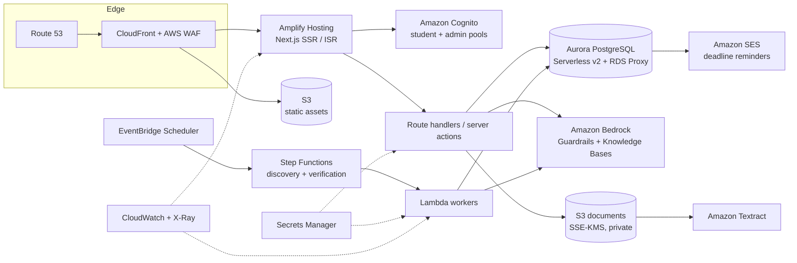

# OpportunityLens — Production architecture on AWS

This document describes the target production architecture. It is a design, not a description of
what is deployed today. The hackathon build runs in demo mode (see [architecture-mvp.md](./architecture-mvp.md)).

## Goals

- Serve the public catalogue fast and cheaply, and keep it indexable.
- Keep student data private: per-user isolation enforced in the database, not only in application code.
- Keep eligibility decisions explainable. Generative AI assists. It never decides eligibility.
- Only show opportunities that a human or an auditable pipeline has checked against the provider's source.
- Grow from one university to many without re-architecture.

## Overview

## Components

| Concern | Service | Notes |
| --- | --- | --- |
| DNS, CDN, edge security | Route 53, CloudFront, AWS WAF | Managed rule groups, rate limiting on auth and AI endpoints. |
| Web app | AWS Amplify Hosting | Native Next.js SSR/ISR support. Public catalogue pages are statically generated and revalidated when a listing changes. |
| Authentication | Amazon Cognito | Email + OAuth (Google, institutional SAML/OIDC per university). Admins live in a separate group with mandatory MFA. |
| Relational data | Aurora PostgreSQL Serverless v2, RDS Proxy | Same schema as `supabase/migrations`. Row Level Security keyed on the Cognito `sub` claim set per transaction (`set local app.user_id`). |
| Documents | S3 (private, SSE-KMS), Textract | Transcripts and CVs uploaded via pre-signed URLs; lifecycle rules delete originals after extraction unless the student keeps them. |
| Generative AI | Amazon Bedrock (Claude / Nova), Bedrock Guardrails, Knowledge Bases | Grounded only in the listing text and the student's own profile. Outputs are labelled as AI guidance. |
| Discovery & verification | EventBridge Scheduler, Step Functions, Lambda | Pulls from partner feeds and approved sources, extracts structured requirements with Bedrock, and queues every candidate for human review before publishing. |
| Notifications | Amazon SES (email), optionally SNS | Deadline reminders and status nudges, opt-in only. |
| Secrets | AWS Secrets Manager, KMS | No secrets in client bundles; `NEXT_PUBLIC_*` variables carry only public values. |
| Observability | CloudWatch Logs/Metrics, X-Ray, CloudWatch RUM | PII-scrubbed logs; alarms on error rate, latency and AI spend. |
| Infrastructure as code | AWS CDK (TypeScript) | One stack per environment (dev, staging, prod) in separate accounts under AWS Organizations. |

## Key flows

### Eligibility check

1. The student's profile is loaded from Aurora (RLS limits the query to their rows).
2. The deterministic rules engine (`src/lib/eligibility`) evaluates every structured requirement. It runs
   identically in the browser and on the server.
3. The result, with the engine version, is stored in `eligibility_assessments` for history and analytics.
4. Optional: the student asks for an AI explanation. Bedrock receives the listing text, the rules engine
   result and the non-sensitive profile summary. It may explain or suggest next steps, but cannot change the outcome.

### Opportunity discovery and verification

1. Scheduled Step Functions workflows fetch from partner APIs and approved public sources (respecting robots.txt and terms).
2. A Lambda worker uses Bedrock to extract structured requirements and highlights unparseable conditions as `other`
   (which the engine always routes to manual review).
3. Candidates land in `draft`. An admin compares them with the source, then publishes. Each check writes an `opportunity_verifications` row.
4. A weekly re-verification job marks listings `needs_reverification` or `source_unreachable` when the source changes or disappears.

### Document understanding (P2)

Uploads go straight to S3 via pre-signed URLs. Textract extracts text; Bedrock proposes profile updates
(grades, skills, experience) that the student must confirm before anything is saved.

## Security and privacy

- **Isolation:** RLS on every student table; admins cannot read `profile_sensitive_details`.
- **Consent:** citizenship and date of birth are optional, consent-timestamped and deletable on their own.
- **Least privilege:** Lambda roles are scoped per function; the web tier cannot touch the documents bucket except through pre-signed URLs.
- **Encryption:** TLS everywhere; KMS keys for Aurora, S3 and Secrets Manager.
- **AI safety:** Bedrock Guardrails for PII redaction and denied topics; prompts never include sensitive details; every AI output is labelled.
- **Data rights:** self-service export and account deletion (cascade deletes through foreign keys, S3 object deletion via event).

## Scaling and cost

- Catalogue reads are served mostly from CloudFront; Aurora Serverless v2 scales from a low ACU floor.
- Bedrock calls are user-initiated and rate-limited per account, with a monthly budget alarm.
- Multi-university: `institutions` table and Cognito federation per institution; tenant-scoped admin roles.

## Migration path from the MVP

1. **P1:** Supabase (Postgres + Auth) behind the existing `OpportunityRepository` interface, using the same schema.
2. **P2:** Bedrock analysis, document pipeline and notifications added as server-side modules.
3. **AWS move:** Because the schema is plain Postgres and data access goes through repositories, moving to
   Aurora + Cognito means replacing the auth adapter and connection layer only. Policies are ported from
   `auth.uid()` to a session variable set by the server.
